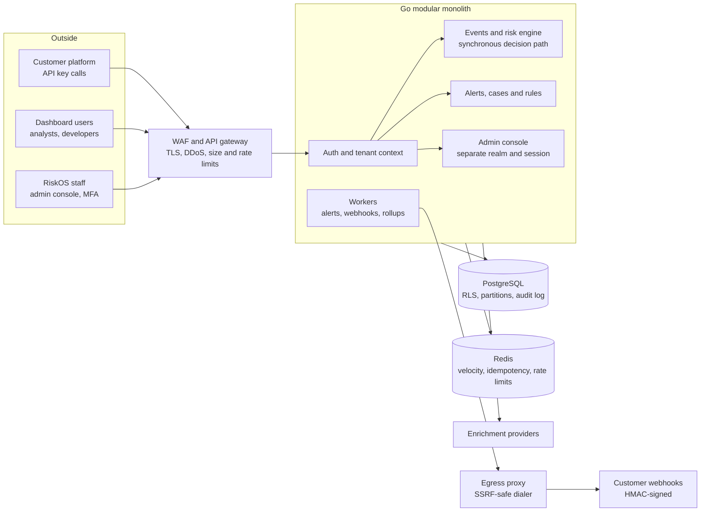
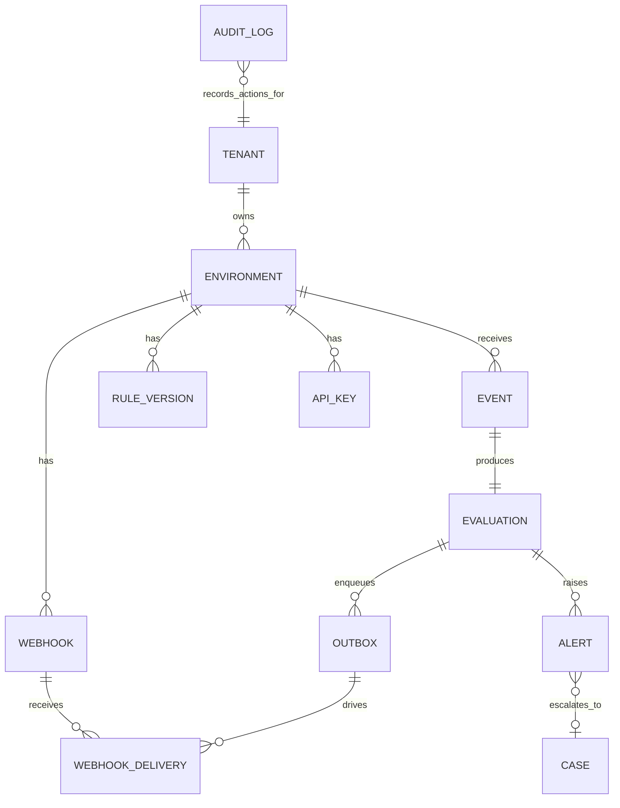

# RiskOS System Design & Architecture

> **Status of this document.** This is the Phase 0 design and the source of truth for
> architecture. The product specification is in [`docs/spec/`](spec/RiskOS_Complete_Implementation_Specification.md).
> Where this file and the spec differ, this file wins: it supersedes the spec's Python/FastAPI
> recommendation with Go, and it resolves the spec's score-math, decision-policy and API-gap issues
> (sections 10, 11 and 17). Numbers marked "assumption" are planning values to validate with the
> benchmark spike, not commitments. Nothing here claims regulatory compliance.
>
> What is already built and enforced is recorded in
> [Appendix A](#appendix-a-implementation-status). Deviations from this design are recorded as ADRs
> in [`docs/adr/`](adr/) and listed in [Appendix B](#appendix-b-recorded-deviations).

Sep 30, 2026 · @Justus

## 1. Purpose, goals and stack

RiskOS is a Go modular monolith that returns an explainable risk decision synchronously inside a tight latency budget, and moves everything else (alerts, webhooks, analytics, AI) off that path.

**Goals**

- An external platform sends an event securely and gets score, level, signals, engine version and decision back, with core evaluation p95 under 200 ms (internal target: 60 ms).
- Strict tenant isolation, enforced in three independent layers.
- Every decision is reproducible from stored inputs and an immutable engine version.
- Every material action is audited in a tamper-evident log.
- Analysts can investigate any decision through alerts, cases and evidence.

**Non-goals for the MVP**

- Machine-learning models on the decision path (AI assists investigations only).
- Multi-region active-active deployment.
- Microservices. Extraction happens only at the triggers in section 13.

**Architecture principles**

1. Infrastructure first, dashboard second.
2. The synchronous path does the minimum: authenticate, validate, enrich from fast stores, score, persist, respond.
3. Deny by default. Tenant identity comes only from the authenticated credential, never from client input.
4. Contract first: `openapi.yaml` is the source of truth for the server and the dashboard client.
5. Decisions are deterministic and versioned. Anything probabilistic is advisory.
6. Every dependency has a timeout, a failure policy and a metric.

**Stack**

| Layer | Choice | Reason |
| --- | --- | --- |
| Backend | Go, `net/http` + `chi` | Predictable latency, low overhead, memory-safe, single static binary |
| Data access | `pgx/v5` + `sqlc` | Type-safe SQL, no ORM surprises, clean fit with row-level security |
| Database | PostgreSQL 16 | Transactions, RLS, partitioning, PITR |
| Hot state | Redis 7 + Lua | Atomic velocity counters, idempotency fast path, rate limits |
| Jobs | River (Postgres-backed) | Transactional enqueue gives the outbox pattern without extra machinery ([ADR-0003](adr/ADR-0003-river-job-queue.md)) |
| Contract | OpenAPI 3.0.3, `oapi-codegen` | One contract drives Go server and TypeScript client (3.1 deferred: [ADR-0004](adr/ADR-0004-openapi-3-0.md)) |
| Frontend | Next.js, TypeScript, Tailwind, shadcn/ui, TanStack Query | Generated typed client, fast dashboard |
| Telemetry | OpenTelemetry, `slog` JSON | Trace and log correlation by request ID |

## 2. Assumptions and capacity

The design targets 500 events per second at peak on one primary database, and every number below is an assumption to confirm with real customer volumes.

| Assumption | Value | Why it matters |
| --- | --- | --- |
| Peak ingest | 500 events/s | Sizes pools, Redis and the write path |
| Average ingest | 100 events/s (8.6M events/day) | Sizes storage |
| Stored size per event | ~3 KB (raw, normalized, evaluation, indexes) | 26 GB/day |
| Hot retention | 90 days (configurable per tenant) | ~2.3 TB in partitions |
| Active entities | 2M (users, accounts, devices, IPs) | Redis memory |
| Velocity keys per event | 5 entities x 3 windows | Redis writes per event |
| Tenants | 50 at launch, 500 within a year | Noisy-neighbor controls |

**Capacity checks**

- **Database writes:** each event writes 3 rows (event, evaluation with signals, outbox), so about 1,500 inserts/s at peak. A single well-provisioned Postgres primary handles this with headroom.
- **Connections (Little's law):** at 500 requests/s and ~8 ms of database time per request, about 4 connections are busy at once. A pool of 20 per API instance through PgBouncer is ample.
- **Redis:** 2M entities x 15 keys x ~100 bytes is about 3 GB, so plan a 6 GB instance and alert at 70% memory.
- **API instances:** Go handles thousands of requests/s per core for this workload. Start with 3 instances for availability, not for throughput.
- **Retention lever:** raw payloads are the largest field. Dropping them at 30 days while keeping normalized data and evaluations should save roughly a third of storage, if raw is about 1 KB of the 3 KB assumed.

## 3. System context and containers



Customers reach the system only through the edge. The events and risk engine box is the synchronous decision path, and the monolith boundary is the single deployable that later splits along the module lines in section 13.

## 4. Module map and layering

Each module exposes a small public interface and hides everything else behind Go `internal/` packages, so the compiler enforces the boundaries and a linter enforces the direction of dependencies.

**Layering rule inside every module:** HTTP handler calls service, service calls store, and only the store touches the database. Modules talk to each other only through public interfaces, never through another module's store or models.

| Module | Owns | May depend on |
| --- | --- | --- |
| `platform` | Config, logging, HTTP middleware, DB and Redis clients, request context, IDs, clock | Nothing internal |
| `auth` | API-key verification, user sessions, MFA, RBAC checks | `platform`, `tenants`, `audit` |
| `tenants` | Tenants, environments, memberships, limits | `platform`, `audit` |
| `events` | Ingest, validation, normalization, idempotency | `platform`, `auth`, `risk`, `audit` |
| `transactions`, `users`, `accounts`, `devices` | Entity read models and enrichment lookups | `platform` |
| `risk` | Signal generators, scoring, decision policy, engine versions | `platform`, `rules`, entity modules |
| `rules` | Rule definitions, versions, compiled evaluation trees, testing | `platform`, `audit` |
| `alerts`, `cases` | Alert lifecycle, investigation workspace, notes, evidence | `platform`, `audit`, entity modules |
| `webhooks` | Endpoints, signing, delivery, retries | `platform`, `jobs`, `audit` |
| `audit` | Append-only, hash-chained audit log | `platform` |
| `admin` | Internal console: tenant operations, security center | Any module through public interfaces only, separate auth realm |
| `jobs` | Queue abstraction over River | `platform` |

**Rules the linter enforces**

1. `platform` and `audit` never import another module.
2. No import cycles between modules. Cross-module needs go through interfaces defined by the consumer.
3. Only `cmd/api` and `cmd/worker` wire modules together (composition root, no globals).
4. Only stores import `pgx` or `go-redis` types.

How each rule is enforced today is listed in [Appendix A.2](#a2-enforcement).

## 5. Synchronous decision path

The path from request to response does only what the decision needs, and its planned 30 ms total leaves 30 ms of headroom under the 60 ms internal target and 170 ms under the 200 ms ceiling.

| Step | Start (ms) | End (ms) | Budget (ms) |
| --- | --- | --- | --- |
| Edge and TLS | 0 | 3 | 3 |
| API key check (cache) | 3 | 4 | 1 |
| Tenant context, rate limit | 4 | 6 | 2 |
| Validate, normalize | 6 | 7 | 1 |
| Idempotency check | 7 | 8 | 1 |
| Enrichment lookups (parallel group) | 8 | 16 | 8 |
| - Rules (in memory) | 8 | 9 | 1 |
| - Velocity (Redis Lua) | 8 | 11 | 3 |
| - Behavioral baseline | 8 | 10 | 2 |
| Score and policy | 16 | 17 | 1 |
| Persist in one transaction | 17 | 29 | 12 |
| Serialize response | 29 | 30 | 1 |

Enrichment, rules, velocity and baseline run in parallel, so the parallel group costs 8 ms, not the sum of its rows. Total: 30 ms.

These figures are planning assumptions; the benchmark spike in the build order replaces them with measured numbers before any is treated as a commitment. The measured baseline for the HTTP layer alone is in [PERFORMANCE_BASELINE.md](PERFORMANCE_BASELINE.md). The persist step writes the event, the evaluation and the outbox rows in one transaction, so nothing is visible to analysts or webhooks until the decision is durable.

**Forbidden on this path:** webhook delivery, analytics, AI calls, unbounded or uncached enrichment, schema migrations, and any call without a timeout.

**Deadlines.** The request carries a single `context` deadline. Enrichment and signal lookups run concurrently under `errgroup` with per-call timeouts (assumption: 15 ms each); a timeout skips that signal and marks it degraded rather than failing the request.

## 6. Asynchronous paths

The decision transaction writes the event, the evaluation and one outbox row together, so alerts and webhooks can never be lost or disagree with the decision the customer received.

**Transactional outbox.** Inside the same Postgres transaction that stores the evaluation, the API enqueues River jobs (or writes outbox rows that a relay drains). If the transaction commits, the jobs exist; if it rolls back, they never did. Workers then process them at least once, and each job carries an idempotency key so retries are safe.

| Job | Trigger | Behavior on failure |
| --- | --- | --- |
| Create alert | Evaluation at or above the tenant's alert threshold | Retry with backoff; alert creation is idempotent per evaluation ID |
| Deliver webhook | Alert created, decision made, case changed | Exponential backoff with jitter, then dead-letter after the retry limit; every attempt logged |
| Analytics rollup | Evaluation stored | Rebuildable from evaluations, so loss only delays dashboards |
| Behavioral baseline update | Event stored | Rebuildable; never blocks the decision |
| Retention sweep | Schedule | Drops expired partitions; every run audited |
| Optional enrichment refresh | Schedule or cache miss | Failure only reduces future signal coverage |

**Rules for the async side**

- Nothing on this side may change a decision already returned to the customer. Changes create new records (a case note, a resolution), never edits.
- Workers are stateless and horizontally scalable. Queue depth and job latency are first-class metrics with alerts.
- Webhook delivery never shares a worker pool with alert creation, so a slow customer endpoint cannot delay alerts.
- Future AI workloads (case summaries, investigation assistant) run here, read-only and permission-aware, and never write to decision tables.

## 7. Data architecture

Every table carries tenant and environment IDs, the two large tables are partitioned by time, and evaluation and audit records can never be updated.



Every table carries `tenant_id` and `environment_id`. Events and evaluations are partitioned by time. Evaluations and audit entries are never updated. The diagram shows the core relationships; supporting tables (sessions, memberships, idempotency records, evidence, support access grants) follow the same rules.

| Topic | Design |
| --- | --- |
| IDs | Type-prefixed UUIDv7 (for example `evt_...`): sortable by time, not enumerable, safe to expose. Request correlation IDs are separate (Appendix B) |
| Partitioning | `events` and `evaluations` partitioned by time (daily or weekly). Retention drops whole partitions, which is fast and does not bloat the table |
| Indexes | Tenant-scoped composite indexes that start with `(tenant_id, environment_id, ...)`; unique index on `(tenant_id, environment_id, event_key)` for idempotency |
| Payload storage | Raw and normalized payloads stored separately; raw payload compressed and droppable earlier than normalized data; sensitive fields masked in UI and logs |
| Immutability | Evaluations, signals and audit entries are insert-only. Corrections are new records that reference the old one |
| Audit log | Append-only; each entry stores the hash of the previous entry so tampering is detectable; only the audit module writes; tenant admins can read their own entries but cannot alter or delete them |
| Queries | `sqlc` queries live next to each store; every query on a tenant table takes tenant and environment parameters |

## 8. Tenancy and isolation

Every row carries `tenant_id` and `environment_id`, and isolation is enforced in three independent layers so one bug cannot expose another customer's data. Details: [TENANCY.md](TENANCY.md).

**Where the tenant comes from.** Only from the authenticated credential: the API key record for machine calls, the session for dashboard users. A tenant ID in a URL, header or body is ignored for authorization and rejected if it disagrees with the credential.

**How it travels.** The auth middleware puts an immutable `TenantContext` (tenant, environment, actor, scopes) into the request `context.Context`. Stores accept the context and refuse to run without it. Job payloads and Redis keys carry the tenant ID as a prefix.

**Three enforcement layers**

1. **Application layer:** every `sqlc` query takes `tenant_id` and `environment_id` as parameters. A lint rule and code review reject queries on tenant tables without them.
2. **Database layer:** PostgreSQL row-level security policies compare each row to a transaction-scoped setting (`SET LOCAL app.tenant_id`). The setting is applied inside each transaction, never on a pooled connection at rest, so connection reuse cannot leak context. The application connects as a role without `BYPASSRLS`.
3. **Test layer:** an automated matrix calls every endpoint with every ID type from a second tenant and expects a 404. It runs in CI and blocks merges.

**Environments.** Test and production are separate environments under one tenant, with separate API keys, rules, data and webhooks. A test key can never read production rows, and production configuration changes are audited.

**Internal support access.** RiskOS staff have no standing access to tenant data. Support access is a time-boxed, approved grant recorded in `support_access_grant`, visible to the tenant, and every read under it is audited.

**Noisy neighbors.** Rate limits and concurrency caps apply per tenant, per key and per endpoint, so one customer's spike cannot starve others.

## 9. Security architecture

RiskOS separates three authentication realms so a compromise in one cannot become a compromise in another, and it denies everything not explicitly allowed. Controls and their status: [SECURITY.md](SECURITY.md).

| Realm | Who | Credential | Notes |
| --- | --- | --- | --- |
| API | Customer systems | Scoped API key per environment | No sessions, no cookies; rate limited per key |
| Dashboard | Customer analysts, developers, admins | Password plus MFA (passkeys preferred), server-side session | Session and device tracking; re-authentication for high-impact actions |
| Internal admin | RiskOS operations and security staff | SSO plus mandatory MFA or hardware key | Separate route prefix and session store; can later move to its own deployable |

**API keys**

- Format: a public prefix for lookup plus a high-entropy secret. Only an HMAC of the secret (with a server-side pepper held in the secrets manager) is stored, and comparison is constant-time.
- The full secret is shown once. Rotation gives an overlap window; revocation takes effect through a short-lived in-memory cache with a 5-second maximum staleness (assumption) and a Redis invalidation signal.
- Scopes are least-privilege, for example `events:write` or `risk:evaluate`, and are checked on every route.

**Authorization.** Role-based access control follows the spec's roles (analyst, risk manager, developer, customer admin, compliance officer, auditor, operations admin, security admin) against resources and actions. Customer roles and internal roles are separate sets. The default answer is deny.

**Webhook signing.** Each delivery carries a timestamp, event ID and an HMAC-SHA256 signature over both plus the body. Receivers reject timestamps outside a 5-minute tolerance and repeated event IDs. Webhook secrets are shown once.

**SSRF defense for customer URLs.** Only HTTPS. Resolve DNS, then dial the resolved IP through a custom dialer that refuses private, loopback, link-local and metadata ranges, so DNS rebinding cannot bypass the check. Deliveries leave through an egress proxy with an allow policy.

**Rate limiting and abuse.** Token buckets in Redis, keyed by tenant, key, IP and endpoint, with request-size limits and strict schema validation at the edge. Repeated violations feed the Security Center.

**Data protection.** TLS everywhere; encryption at rest for database, Redis persistence and backups; secrets only in a secrets manager; log redaction for keys, tokens and PII-like fields; sensitive fields masked in the UI by default.

**Supply chain.** Pinned modules, `govulncheck` and dependency scanning in CI, SBOM per build, image scanning, and signed images.

## 10. Risk engine

The engine is a deterministic pipeline of signal generators, an additive aggregator and a separate decision policy, so a new signal type plugs in without touching scoring or policy. Details: [RISK_ENGINE.md](RISK_ENGINE.md).

**Pipeline.** Rules, velocity, behavioral, device and geo generators run concurrently and each returns zero or more signals `{code, label, weight, evidence_ref}`. The aggregator sums them, the policy maps the result to a decision, and the whole evaluation is stored immutably.

**Scoring formula (resolves the spec's 87 vs 59 inconsistency).**

```math
\text{score} = \min\left(100,\ \sum_{s \in \text{triggered}} w_s\right)
```

Weights are integer points. Every point in the score must appear in the response as a listed signal, so the response is always reproducible from its own signals. The spec's example of 87 with three signals summing to 59 is treated as an illustration error. Tenants may tune weights within bounds set by the engine version; they cannot add unbounded weight.

**Levels.** 0-29 low, 30-59 medium, 60-79 high, 80-100 critical. These are product defaults, tenant-adjustable, and never presented as industry standards.

**Decision policy (resolves the spec's CRITICAL leading to REVIEW).** The score sets the level; a separate, tenant-configurable policy sets the decision.

| Level | Default decision | Overrides |
| --- | --- | --- |
| Low | ALLOW | None |
| Medium | ALLOW | STEP-UP when a strengthenable signal fired (new device, geo anomaly) |
| High | STEP-UP | REVIEW when the event type cannot be stepped up |
| Critical | REVIEW | BLOCK when the tenant enables auto-block or a hard-block rule matches (for example a customer deny-list hit) |

Hard-block rules override the score. Any BLOCK is explained by named signals, and decisions are always advisory to the customer's own flow, which enforces them.

**Rules DSL.** Rules are JSON documents with typed fields, operators, AND/OR groups, priority, severity and weight. There is no `eval`, no scripting and no customer code. A rule set compiles into an in-memory evaluation tree cached per tenant, environment and version, with a maximum depth and node count and a hard evaluation time bound. Rules are versioned, testable against synthetic and historical events, roll back in one step, and production changes can require approval.

**Money.** Amounts are integer minor units plus an ISO 4217 currency. Rule thresholds are per currency; no FX conversion happens on the hot path.

**Velocity on Redis.** One Lua script per entity per event increments bucketed counters (1-minute buckets, read as sliding 1-minute, 1-hour and 24-hour windows) atomically and returns the counts in the same round trip. Keys are prefixed by tenant and environment and expire with their longest window. If Redis is unavailable, velocity signals are skipped, the response lists them under `degraded_signals`, and the tenant's fail policy applies (section 12).

**Behavioral baselines.** Per-user baselines (typical amounts, hours, countries, devices) are precomputed asynchronously and read on the hot path. New users with no history get a defined cold-start behavior: no anomaly signals, and a small "new entity" signal instead.

**Reproducibility.** Each stored evaluation keeps the engine version, rule version IDs, the feature values used, all signals and the decision. Re-running an old evaluation against its recorded inputs must give the same result.

**Safe rule change.** A challenger rule set can run in shadow mode: it evaluates in the background, its results are stored and compared, and it never affects the response until promoted.

**Score probing.** Responses to customers include signals as the spec requires, but the API returns weights and codes only for the customer's own tenant, is rate limited per key, and flags patterns like systematic parameter sweeps to the Security Center.

## 11. Events and idempotency

A duplicate request returns the original stored response and never triggers a second evaluation, and two concurrent duplicates are resolved by the database, not by timing. Details: [EVENTS.md](EVENTS.md).

**Endpoint roles (resolves the overlap in the spec).**

| Endpoint | Persists | Use |
| --- | --- | --- |
| `POST /api/v1/events` | Yes: event, evaluation, outbox | Primary path. Ingests an event and returns the risk decision in the same response |
| `POST /api/v1/risk/evaluate` | No event record; stores an evaluation flagged as a dry run | What-if checks and integration testing; never triggers alerts or webhooks |

**Event envelope.** Every event carries `event_id` (customer-supplied, unique per tenant and environment), `type`, `occurred_at`, `actor` references (user, account, device, session), `context` (IP, user agent, location) and a typed `data` object per event type (login, transaction, beneficiary added, device or session change, profile change). Schemas are versioned; unknown fields are rejected in strict mode and additive changes are backward compatible.

**Validation limits.** Maximum body size (default 64 KB, assumption), maximum nesting depth, timestamps within an allowed skew of server time (default 5 minutes ahead, 24 hours behind, assumption), and strict types. Money is integer minor units with a currency code.

**Idempotency design**

1. The idempotency key is the `event_id`, or an `Idempotency-Key` header, scoped to `(tenant, environment, key)`.
2. Fast path: Redis `SET NX` with a short TTL marks the key in-flight.
3. Source of truth: a unique index on `(tenant_id, environment_id, event_key)` in Postgres. The insert is `ON CONFLICT DO NOTHING`; the loser reads the winner's stored response.
4. Same key, same payload hash: replay the stored response with an `Idempotent-Replay: true` header.
5. Same key, different payload hash: `409 IDEMPOTENCY_CONFLICT`. Nothing is evaluated.
6. Retention of idempotency records matches the event retention window.

**Replay protection.** Timestamp skew limits plus the unique key stop old requests from being reprocessed. Behavior on stale events is a per-endpoint policy: reject with `422 STALE_EVENT` for real-time endpoints, accept-without-alerting for batch backfills.

**Response and error contracts** follow the spec exactly: the risk response with `risk_score`, `risk_level`, `decision`, `engine_version` and `signals`, plus `degraded_signals` when optional sources failed and `warming_signals` while behavioural history rebuilds after a feature-store reset; errors return `{error: {code, message, request_id}}`.

## 12. Failure modes

Each tenant chooses a fail policy for a degraded engine: **fail-open** (return ALLOW with a degraded flag) or **fail-closed** (return REVIEW). The default is fail-closed for transactions and fail-open for logins, and the choice is recorded per tenant.

| Failure | Effect | Behavior | Signal to operators |
| --- | --- | --- | --- |
| Redis down | No velocity, no fast idempotency check | Skip velocity signals, list under `degraded_signals`, rely on the Postgres unique index for idempotency, apply fail policy | Critical alert; Redis health metric |
| Postgres primary slow or failing over | Writes stall | Requests hit the per-request deadline and return `503` with `Retry-After`; no partial state because the write is one transaction | Latency and error-rate alerts |
| Enrichment provider down or slow | Missing IP, geo or device intel | Hard timeout, skip the signal, list as degraded; never block the decision | Provider error-rate metric |
| Queue backlog | Alerts and webhooks delayed | Decisions are unaffected; backlog alert fires at a depth or age threshold | Queue depth and oldest-job age |
| Worker crash | In-flight job interrupted | Job is retried; handlers are idempotent | Job failure metric |
| Duplicate or replayed request | Possible double processing | Idempotency layer returns the stored response | Replay counter per tenant |
| Crash mid-request | Partial work | Nothing is visible until the single transaction commits; the client retries with the same key | Trace with error status |
| Customer webhook endpoint down | Deliveries fail | Exponential backoff with jitter, then dead-letter; visible in delivery logs | Per-endpoint failure rate |
| Traffic spike from one tenant | Shared capacity at risk | Per-tenant rate limits and concurrency caps; load shedding returns `429` before saturation | Rate-limit violation counter |

**Principle:** a dependency failure may reduce signal coverage, and the response must say so. It may never silently lower risk without the degraded flag.

**Guardrail against induced degradation.** Fail-open must not become an attack path: when any signal source is degraded, events above the tenant's high-value threshold are raised to at least REVIEW whatever the fail policy says, and the degradation is reported as a security event (section 16.8).

## 13. Scalability and extraction triggers

Scale the stateless tiers first, then the data tier, and extract a component from the monolith only when a measured trigger below is hit.

**Scaling order**

1. **API and worker instances:** add replicas behind the gateway; they hold no state.
2. **PgBouncer and connection pools:** pool per instance, transaction pooling at the bouncer. pgx must then run in a PgBouncer-safe query mode (Appendix B).
3. **Redis:** move to a managed HA setup, then to a cluster keyed by tenant prefix.
4. **Postgres reads:** add read replicas for dashboards, analytics and case investigation queries.
5. **Postgres writes:** time-partition the event and evaluation tables, then hash-partition by tenant for very large tenants, and move cold partitions to cheaper storage.

**Extraction triggers**

| Component | Extract when | Interface already in place |
| --- | --- | --- |
| Event ingest and risk evaluation | Sustained load above ~70% of one primary's write capacity, or its deploy cadence must differ from the dashboard API | `events` and `risk` public interfaces, OpenAPI contract |
| Webhook dispatcher | Delivery volume or slow customer endpoints affect worker latency | `webhooks` module and `jobs` interface |
| Analytics | Dashboard queries visibly affect the primary even with replicas | Read-only rollup tables |
| Admin console | Compliance or access-control needs require a separate deployable and network | Separate auth realm and route prefix |

**Hot-tenant controls.** Per-tenant concurrency caps, per-tenant queues for webhooks, and the option to pin a very large tenant to a dedicated partition set or database.

## 14. Observability, deployment and recovery

Every request is traceable end to end by one request ID, and production is split into network zones so the database and Redis are never reachable from the internet.

**Observability**

- **Correlation:** a request ID is generated or accepted at the edge, echoed in responses and errors, and attached to every log line, span and job.
- **Service level indicators:** API request rate, p50/p95/p99 latency, evaluation latency, ingest success rate, queue depth and oldest-job age, Postgres and Redis health, webhook success rate, authentication failures, rate-limit violations.
- **Targets (assumptions):** core evaluation p95 under 200 ms, 99.9% monthly availability for ingest, webhook first-attempt success tracked per endpoint rather than promised.
- **Go runtime metrics:** goroutines, GC pause, heap size, connection pool wait time.
- **Health:** `/health/live`, `/health/ready` (checks Postgres and Redis), and separate readiness for the worker.

**Deployment topology**

| Zone | Contains | Reachable from |
| --- | --- | --- |
| Edge | WAF, API gateway, DDoS protection, TLS termination | Internet |
| Application | API instances, dashboard, admin console (separate route and realm) | Edge only |
| Workers | Job workers, webhook egress proxy | Application zone; egress proxy only to internet |
| Data | Postgres primary and replicas, PgBouncer, Redis | Application and worker zones only |
| Operations | Secrets manager, telemetry collector, backups | Restricted operator access, audited |

Test and production run as separate environments with separate credentials, databases and networks. Migrations follow expand-then-contract rules so deploys have no downtime, and production access is controlled, time-limited and audited.

**Backup and recovery.** Encrypted automated backups with point-in-time recovery, proposed targets of RPO 5 minutes and RTO 1 hour (assumptions to confirm), monthly restore tests, and queue retry with dead-letter handling. Incident runbooks cover key compromise, a cross-tenant data exposure, a bad rule deployment and queue backlog.

## 15. Threat model

Eighteen threats drive the controls in this document; each has a mechanism and a test, and none relies on a single layer. The register with implementation status is maintained in [THREAT_MODEL.md](THREAT_MODEL.md).

| # | Threat | Impact | Controls | Proof |
| --- | --- | --- | --- | --- |
| 1 | Compromised API key | Fake events, score probing, data reads | Scopes, optional per-key IP allowlist, per-key rate limits, secret-scanner-friendly key prefix, anomaly alerts on new network or volume, instant revocation | Revoked key rejected within the staleness bound; new-ASN use raises an alert |
| 2 | Cross-tenant access (IDOR) | Customer data exposure | Tenant from credential only, tenant-scoped queries, row-level security, uniform 404 | Cross-tenant matrix on every endpoint in CI |
| 3 | Replay or duplicate submission | Double processing, forged history | Unique event key, timestamp skew limits, stored-response replay | Replay and concurrent-duplicate tests |
| 4 | Credential stuffing or takeover of dashboard accounts | Analyst or admin compromise | Mandatory MFA (passkeys preferred), breached-password check, login rate limits, session and device tracking, anomaly detection | Brute-force test is throttled; impossible-travel alert |
| 5 | Webhook spoofing or replay | Customers act on fake decisions | HMAC signature, timestamp tolerance, event ID, secret rotation | Bad signature and stale timestamp rejected |
| 6 | SQL injection | Data compromise | `sqlc` parameterized queries only, no string-built SQL, lint rule, least-privilege DB role without `BYPASSRLS` | Injection payload suite; static scan |
| 7 | SSRF via webhook URLs | Internal network access, metadata theft | HTTPS only, resolved-IP dialer blocking private ranges, egress proxy, redirects disabled | Private-IP, redirect and DNS-rebinding tests |
| 8 | Privilege escalation or insider abuse | Admin compromise, silent data access | Least privilege, four-eyes on sensitive changes, just-in-time expiring access, break-glass with alert, full audit | Attempted self-approval is denied; break-glass fires an alert |
| 9 | DDoS and resource exhaustion | Availability loss | WAF, per-tenant limits, body and depth limits, bounded rule complexity, RE2-only matching (linear time) | Load test with oversized payloads and pathological rules |
| 10 | Malicious or mistaken rule change | Bad decisions at scale | Versioning, four-eyes approval for production, shadow mode, one-step rollback, audit | Unapproved promotion blocked; rollback restores prior decisions |
| 11 | Score probing and evasion | Attacker learns how to stay under thresholds | Per-key limits, sweep-pattern detection, no rule internals in responses, tenant-only visibility of signals | Sweep simulation triggers Security Center event |
| 12 | Attacker-induced degradation | Forced fail-open lets fraud through | High-value floor during degradation, degradation treated as a security event | Kill Redis in test; high-value transactions still reach REVIEW |
| 13 | Baseline poisoning | Attacker slowly trains the model that fraud is normal | Capped baseline update rate, flagged events excluded from baselines, drift alerts | Poisoning simulation does not move thresholds beyond the cap |
| 14 | Secret leakage | Credential compromise | Secrets manager, redaction, pre-commit and CI scanning, no secrets in images or logs | Canary secret never appears in logs |
| 15 | Supply-chain compromise | Malicious code in build or dependencies | Pinned modules, signed images, provenance, SBOM, two-person review, vulnerability gates | Unsigned image refused at deploy |
| 16 | Audit tampering | Loss of accountability | Hash chain, external anchor, write only through audit module, separate storage account for anchors | Chain verification job detects a modified row |
| 17 | Bulk exfiltration through export or analytics | Mass data loss | Export scopes, step-up authentication, rate limits, volume alerts, masked defaults | Large export requires re-auth and raises an alert |
| 18 | Backup theft or ransomware | Data loss or exposure | Encrypted, immutable backups in a separate account, restore drills | Restore test from an isolated account |

## 16. Additional controls from the security review

The sections above meet the spec; the controls below close gaps a financial-sector security review would raise, because banks and payment companies will test them during vendor due diligence.

**16.1 Privileged access and separation of duties**

- Four-eyes approval for: production rule promotion, tenant suspension, support access grants, key-pepper rotation, and audit or retention configuration changes. The requester can never approve their own request.
- No standing production access. Engineers and support get just-in-time access that expires (default 4 hours, assumption), with a reason and a ticket ID recorded.
- Break-glass accounts exist, are sealed, and raise a critical alert on any use.
- The admin console is reachable only through a private access path (zero-trust proxy or VPN) plus an IP allowlist, with hardware-key MFA. No shared accounts anywhere.

**16.2 Cryptography and key management**

- Envelope encryption: a KMS-held master key wraps per-tenant data keys; sensitive fields are encrypted with the tenant's key. Deleting a tenant's key is how their data is rendered unrecoverable (crypto-shredding).
- The API-key pepper and webhook-signing master secret live in the secrets manager or KMS, with a documented rotation that verifies against old and new values during the overlap.
- TLS 1.2 or higher (1.3 preferred) everywhere, including inside the private network. No custom cryptography; use the Go standard library and vetted packages only. Use a FIPS-capable build if a customer contract requires it.
- Proposed rotation cadence (assumptions): data keys yearly, pepper yearly, TLS certificates automated.

**16.3 Data minimization and privacy**

- RiskOS never accepts full card numbers, CVV, PINs, passwords or authentication secrets. The validator rejects payloads containing them, which keeps the platform out of card-data scope. Bank account numbers are accepted only as tokens or masked values.
- Identifiers used for velocity and matching (account, device, IP, beneficiary) are keyed-hashed per tenant before they reach Redis, so a Redis dump contains no raw identifiers.
- Every field has a classification (public, internal, confidential, restricted) that drives masking, encryption, logging and retention.
- Deletion and export requests: PII fields are removed or crypto-shredded; audit entries keep only pseudonymous IDs so the audit chain stays intact.

**16.4 Audit integrity and detection**

- The audit hash chain is anchored every 5 minutes (assumption) to write-once storage in a separate account, so even a database administrator cannot rewrite history unnoticed.
- Application, audit and access logs ship to a tamper-resistant store outside the production account.
- Day-one detections: admin login anomalies, API key used from a new network, spikes in 4xx and 404 per key (IDOR probing), privilege or role changes, production rule changes outside approved windows, repeated RLS denials, mass exports, break-glass use, and any degradation of the risk engine.

**16.5 Secure development and supply chain**

- Protected main branch, two reviewers for security-sensitive modules, signed commits.
- CI gates: `gosec`, Semgrep or CodeQL, `govulncheck`, dependency and container scanning, secrets scanning, infrastructure-as-code scanning.
- Reproducible builds, SBOM per release, signed container images and build provenance; deploys refuse unsigned images.
- Hardened containers: distroless, non-root, read-only filesystem, dropped capabilities.
- Independent penetration test before launch and yearly, plus a published vulnerability disclosure policy (`security.txt`) and remediation targets (assumption: critical within 7 days, high within 30).

**16.6 Regional cells and data residency**

- A region is a self-contained cell with its own Postgres, Redis, workers and encryption keys. A tenant is pinned to one region at creation and its data never leaves it. The global control plane holds only minimal tenant metadata.
- Launch with one cell; the tenant model and deployment code support more from day one. Which regions to open first, and what each market's rules require, is a legal input; the design makes no compliance claim.

**16.7 API and dashboard hardening**

- Optional per-key IP allowlists, optional mutual TLS, and optional request signing (HMAC over timestamp and body) for high-assurance customers such as banks.
- Recognizable key prefixes (for example `rsk_live_` and `rsk_test_`) so secret scanners can find leaked keys.
- Uniform error responses: cross-tenant and nonexistent resources both return 404, with no timing difference that reveals existence.
- Dashboard: `HttpOnly`, `Secure`, `SameSite=Strict` cookies, CSRF tokens, strict Content-Security-Policy, HSTS, frame denial, idle and absolute session timeouts, SSO (OIDC or SAML) for customer admins, and step-up authentication for exports, key creation and rule promotion.

**16.8 Integrity of the decision system**

- During degradation, any event above the tenant's high-value threshold receives at least REVIEW regardless of fail policy, and degradation itself is a Security Center event.
- Behavioral baselines update at a capped rate and exclude events already flagged high risk, so an attacker cannot slowly retrain what counts as normal.

**16.9 Third parties and assurance**

- Maintain a subprocessor inventory and data processing agreement template, and prepare a security overview, penetration-test summary and incident-notification commitment for customer due diligence. The notification window is set by legal.
- Build controls so they map to common assurance frameworks (SOC 2, ISO 27001) and start collecting evidence early. This is readiness, not certification, and no certification is claimed.

**16.10 Incident response**

- Named security owner and 24/7 on-call, severity definitions, and runbooks for key compromise, cross-tenant exposure, bad rule deployment, ransomware and provider outage.
- Quarterly tabletop exercises, including one that simulates a cross-tenant leak and the customer-notification process.

## 17. Decisions and build order

This design closes the spec's gaps with sixteen decisions; the only inputs still needed are business and legal facts that no design can supply, listed last.

**Decisions made**

| # | Decision | Chosen | Main alternative rejected |
| --- | --- | --- | --- |
| 1 | Backend language | Go | Python/FastAPI (higher per-request overhead, less predictable tail latency) |
| 2 | Tenant isolation | Shared schema, `tenant_id` + Postgres RLS + test matrix | Schema-per-tenant (operational cost at 500 tenants) |
| 3 | Score formula | Sum of signal weights, capped at 100 | Probabilistic combination (harder to explain) |
| 4 | Decision policy | Separate tenant-configurable policy; CRITICAL defaults to REVIEW | Score-only mapping |
| 5 | Endpoints | `/events` persists and decides; `/risk/evaluate` is a dry run | One endpoint with a flag |
| 6 | Queue | River, transactional enqueue | Redis-based queue (no atomic link to the decision commit) |
| 7 | Velocity | Bucketed sliding windows in Redis via Lua | Sorted sets per event (more memory) |
| 8 | IDs | Type-prefixed UUIDv7 | Sequential integers (enumerable) |
| 9 | Audit integrity | Hash-chained append-only log | Plain table (no tamper evidence) |
| 10 | Money | Integer minor units plus currency | Floating point |

**Decisions that closed the open questions and the security review**

| # | Decision | Chosen | Main alternative rejected |
| --- | --- | --- | --- |
| 11 | Data residency | Regional cells; a tenant is pinned to one region and its data never leaves it | One global cluster with tenant tags |
| 12 | Automatic blocking | CRITICAL stays at REVIEW by default. BLOCK is a per-tenant opt-in that requires 14 days (assumption) in shadow mode showing would-have-blocked counts, hard-block rules limited to the tenant's own deny-lists, and a tenant kill switch | Block by default |
| 13 | Enrichment at launch | In-house signals (velocity, device continuity, behavioral baselines) plus an offline IP-to-geo database; third-party vendors plug in later through a provider interface. No customer data leaves the platform at launch | Integrating vendors before launch |
| 14 | Launch volume | 500 events/s peak design point, scaled out by adding instances, with the extraction triggers in section 13 as the escape hatch | Sizing for millions per second up front |
| 15 | Privileged access | Just-in-time expiring access, four-eyes on sensitive changes, sealed break-glass | Standing administrator accounts |
| 16 | Behavior under degradation | Tenant fail policy with a mandatory REVIEW floor for high-value events | Pure fail-open or pure fail-closed |

**The original open questions, now decided**

- Markets and residency: decided, tenants are pinned to a regional cell (section 16.6). Which regulators apply still needs legal input, and nothing here claims compliance.
- Event volume: section 2 assumes 500/s peak as the launch design point; decided to keep it and scale out (decision 14).
- Blocking: decided, CRITICAL starts at REVIEW and automatic BLOCK is an opt-in behind guardrails (decision 12).
- Enrichment: decided, ship with in-house signals and an offline geo database; vendors come later (decision 13).

**Inputs only you or counsel can supply**

- The first target markets and the regulators and contract terms that apply to your first customers.
- Legal review of the residency approach, the data processing agreement and the incident-notification window.
- A named owner for security and on-call before launch.
- An independent penetration-test vendor and date before the first production customer.

**Build order**

1. Foundation and CI (setup prompt). **Done** (Appendix A).
2. Tenants, environments, API keys, audit log, RBAC. **Done** for the API realm (Appendix A.4); dashboard login deferred (Appendix B).
3. Event ingest with idempotency, then a stub evaluation. **Done** (Appendix A.5).
4. Risk engine: rules, velocity, scoring, decision policy. **Done** (Appendix A.6); rule approval and automatic blocking added in build step 8 (A.11); deny-list hard blocks added after build step 8.
5. Alerts, cases, notes, resolution. **Done** (Appendix A.7); alerts reach customers by webhook in step 6.
6. Webhooks with signing and delivery logs. **Done** (Appendix A.8); egress proxy and per-tenant delivery queues deferred (Appendix B).
7. Dashboard on the generated client.
8. Security hardening, load and failure testing, restore drill. **Done for the application** (Appendix A.11); the parts that need deployment infrastructure are listed in Appendix B.

The first milestone is the thin vertical slice: tenant, API key, event, validation, normalization, evaluation, alert, case, resolution and audit log, with a measured latency result against the section 5 budget.

---

## Appendix A. Implementation status

What exists in the repository today (build steps 1-8). Everything above that is not listed
here is designed but not yet built.

### A.1 Repository layout

```
backend/
├── api/openapi.yaml          contract: the source of truth for every HTTP operation
├── cmd/{api,worker,migrate}  composition roots: build dependencies, inject, run
├── db/migrations             goose SQL migrations (embedded in binaries)
├── db/queries/<module>       SQL for sqlc
├── internal/
│   ├── apigen/               generated from openapi.yaml (never edited)
│   ├── httpapi/              composes middleware + generated router + module handlers
│   ├── dbmigrate/            migration runner shared by cmd/migrate and tests
│   ├── jobs/                 queue abstraction over River
│   ├── platform/             config, logging, requestctx, ids, clock, httpx, httpserver,
│   │                         health, telemetry, db (pgxpool, sqlcgen), redisx
│   └── <module>/             auth tenants events transactions users accounts devices
│                             risk rules alerts cases webhooks admin audit observability
└── test/{integration,security,e2e,load}
```

Each domain module has the shape `internal/<module>/` (public interface only) plus
`internal/<module>/internal/{handler,service,store}/`.

### A.2 Enforcement

| Rule (section 4) | Enforced by |
|---|---|
| No access to another module's implementation | Go compiler (`internal/` visibility) |
| No import cycles | Go compiler |
| `platform` never imports a module | depguard `platform-is-foundation` |
| `audit` imports only `platform` | depguard `audit-is-foundation` |
| Only stores use pgx, Redis, `platform/db`, `platform/redisx` | depguard `data-access-only-in-stores` |
| Services and stores do not use HTTP or generated API types | depguard `services-are-transport-agnostic` |
| River only inside `internal/jobs` | depguard `queue-implementation-confined` |
| Composition only in `cmd/*`; configuration read only there; no OpenTelemetry or slog globals | forbidigo |
| No `init()`, no mutable package-level state | gochecknoinits, gochecknoglobals |
| Tenant-scoped query parameters (section 8, layer 1) | Every sqlc query on a tenant table takes `tenant_id` and `environment_id`; stores read them from the scope and only run inside a scoped transaction (`db.TxFrom`) |
| Row-level security (section 8, layer 2) | Policies on every tenant table; api, worker and riskosctl connect as `riskos_app` (no BYPASSRLS, owns nothing) |
| Cross-tenant test matrix (section 8, layer 3) | `backend/test/integration/tenancy_test.go`, required in CI |
| Tenant scope created only by auth, tenant bootstrap and operator tooling | forbidigo rule on `tenancy.WithScope` |

### A.3 Request lifecycle (in place)

Middleware, outermost first (`internal/httpapi/httpapi.go`): OpenTelemetry server span and
metrics (injected providers) → request ID (accepts a safe inbound `X-Request-ID`, otherwise
generates `req_…`) → access log (never query strings, headers or bodies) → panic recovery (500 in
the error contract, stack logged only) → route telemetry (span name and `http.route` from the
route pattern) → security headers → request timeout (context deadline) → body limit (default
64 KB, 413) → routes generated from the OpenAPI contract, with contract-shaped 404/405.

Server limits (`internal/platform/httpserver`): explicit read-header, read, write and idle
timeouts and a header-size limit. On SIGTERM, readiness fails first, the server keeps serving for
the drain delay, then waits for in-flight requests up to the shutdown timeout.

Configuration is environment-only (`RISKOS_*`), loaded once in `cmd/*`, validated at startup, and
passed down explicitly. Production additionally requires verified Postgres TLS and a Redis
password.

### A.4 Tenancy, API keys, audit and RBAC (build step 2)

| Area | What is built |
|---|---|
| Tenants | `tenants` + `environments` (test, production), region pinned at creation, status (active, suspended, disabled). Created by `riskosctl tenant create` in one audited transaction together with the first key |
| Tenant context | `platform/tenancy.Scope` (tenant, environment, principal) in the request context; `platform/txn.Runner` opens a transaction and sets `app.tenant_id` / `app.environment_id` transaction-locally for RLS |
| API keys | `rsk_test_`/`rsk_live_` + 12-char lookup + 32-char secret; HMAC-SHA256 with a pepper (`RISKOS_API_KEY_PEPPER`) stored, constant-time compare; scopes; create, list, rotate (overlap 0-7 days), revoke; a key cannot grant or rotate scopes it lacks |
| Authentication | Middleware on `/api/v1/` before routing; lookup through the `auth_lookup_api_key` SECURITY DEFINER function (the only cross-tenant query); lookup cache TTL 5 s = revocation staleness bound; uniform 401; 403 `TENANT_SUSPENDED` only after the key verifies |
| RBAC | `platform/authz`: permission catalog, customer roles (customer_admin, developer, risk_manager, analyst, compliance_officer, auditor), internal roles with no tenant access; `authz.Require` in services; deny by default |
| Audit log | `audit_log` + `audit_chain_heads`; append-only (grants + trigger); per-tenant SHA-256 chain over a canonical encoding, written in the action's transaction; `riskosctl audit verify` recomputes the chain as the owner |
| API | `GET /api/v1/whoami`, `GET/POST /api/v1/api-keys`, `POST …/{id}/rotate`, `POST …/{id}/revoke`, `GET /api/v1/audit-logs`; cursor pagination |

### A.5 Events and evaluation (build step 3)

| Area | What is built |
|---|---|
| Ingest | `POST /api/v1/events`: contract validation, semantic checks (time window, IP, card numbers), normalization, and one transaction writing idempotency record, evaluation and event ([EVENTS.md](EVENTS.md)) |
| Idempotency | `event_idempotency` primary key is the source of truth; replay returns the stored response with `Idempotent-Replay: true`; different payload is `409 IDEMPOTENCY_CONFLICT` |
| Evaluation | `risk.Evaluator` with the stub engine `risk-engine-stub-0.1`; score formula, levels and default decisions implemented; every evaluation stored reproducibly ([RISK_ENGINE.md](RISK_ENGINE.md)) |
| Dry run | `POST /api/v1/risk/evaluate`: evaluation flagged `dry_run`, no event |
| Explorer | `GET /api/v1/events`, `GET /api/v1/events/{id}` (raw and normalized payloads, evaluation) |
| Storage | `events`, `evaluations` monthly-partitioned on UUIDv7 time, insert-only; partitions kept 3 months ahead by a daily worker job |
| Edge | Contract validation middleware (kin-openapi, spec embedded in the binary); per-key and per-tenant GCRA rate limits in Redis, failing open |
| Measured | Full decision path at 500 events/s: p95 87 ms, at 100 events/s: p95 13.5 ms (laptop; [PERFORMANCE_BASELINE.md](PERFORMANCE_BASELINE.md)) |

### A.11 Hardening and drills (build step 8)

| Area | What is built |
|---|---|
| Failure drill | `make failure-drill`: ingest under load while Redis, PostgreSQL, the worker and the API fail; checks that no event is lost or duplicated, no degraded transaction is allowed, every alert and webhook arrives ([DISASTER_RECOVERY.md](DISASTER_RECOVERY.md)) |
| Restore drill | `make restore-drill`: backup, restore into a fresh server, then row counts, audit chains, isolation and a live API on the copy |
| Automatic blocking | Per environment: off, shadow (Critical evaluations marked `would_block`, counted as evidence), on after 14 days of shadow (Critical gets BLOCK); the kill switch works at once |
| Rule approval | Production rule changes are proposals until a second person with `rules:approve` (people only) approves them |
| Abuse limits | Failed authentications per client address, read through trusted proxies only; per-tenant limits on sensitive operations; breached-password check for console passwords |
| Failing fast | Redis circuit breaker; bounded rate-limit checks; a 1 s deadline to get a database connection, then 503 with `Retry-After`; jobs of a killed worker retried after the job timeout plus a minute |
| Schedule | Both drills run weekly in CI (`.github/workflows/drills.yml`) |

### A.10 Console (build step 7)

| Area | What is built |
|---|---|
| Screens | Overview, events, alerts queue, cases, rules, risk settings, developer center (keys, webhooks, delivery logs), team, audit log, account security ([CONSOLE.md](CONSOLE.md)) |
| Design | The RiskOS design system: light only, brand blue and ink, Inter with IBM Plex Mono for evidence, Phosphor icons, risk bands from the environment's policy, keyboard-first triage, a collapsible navigation and a command palette; shared by the console, the admin realm and the `/home` landing page ([design-system.md](design-system.md)) |
| Environments | One sign-in for test and production, a switch, a PRODUCTION banner; every request and cached query carries the environment |
| Browser security | Same-origin API proxy, nonce-based CSP, HSTS, frame denial; re-authentication prompts for high-impact actions |
| Tests | Component tests; browser tests with a mocked API (desktop and mobile, virtual passkey authenticator, CSP); a browser test against the running stack with no mocks |

### A.9 Console sign-in (build step 7)

| Area | What is built |
|---|---|
| Accounts | Users per tenant with roles; invites as single-use links (operator CLI for the first administrator, the console for the rest), emailed over SMTP when configured; single sign-on with each tenant's OpenID Connect provider ([CONSOLE_AUTH.md](CONSOLE_AUTH.md)) |
| Sign-in | Password (Argon2id) plus a mandatory passkey or authenticator-app code; recovery codes; throttling; uniform failures |
| Sessions | Hashed tokens in HttpOnly SameSite=Strict cookies, CSRF tokens and Origin checks, 12 h absolute / 30 min idle, environment chosen per request, re-authentication for high-impact actions |
| Team | Role and status changes (ending sessions), last-administrator and self-change guards, invite management, all audited |

### A.8 Webhooks (build step 6)

| Area | What is built |
|---|---|
| Events | `alert.created`, `alert.updated`, `case.created`, `case.resolved`, `webhook.test`, recorded in the transaction of the change ([WEBHOOKS.md](WEBHOOKS.md)) |
| Signing | HMAC-SHA256 over id, timestamp and body; secrets derived from a server-side key (never stored), shown once, rotation with an overlap during which both signatures are sent |
| Delivery | Dedicated `webhooks` worker queue; 9 attempts over about an hour with jitter, then dead-letter; manual redelivery; insert-only attempt log without response bodies |
| Health | Endpoints failing every attempt for 3 days are disabled, audited and raise a security alert |
| SSRF | https only, private/reserved addresses refused both in the URL and on the resolved IP at connect time, no redirects, no environment proxy; a dev-only flag for test environments, refused in production |

### A.7 Alerts and cases (build step 5)

| Area | What is built |
|---|---|
| Outbox | The decision transaction inserts an `alerts_raise` job (River) with the event and evaluation; the worker raises the alert. Idempotent per evaluation and alert kind ([ALERTS_AND_CASES.md](ALERTS_AND_CASES.md)) |
| Alerts | `risk` alerts for decisions at the tenant's threshold (REVIEW by default, STEP_UP optional); `security` alerts for degraded evaluations; grouped per subject within 1 hour; triage state machine, assignee, notes, timeline |
| Cases | Create with alerts (escalation), update, resolve with a resolution that closes the alerts, append-only notes, timeline |
| Jobs | Background jobs act through `tenants.JobScope`: the tenant is re-checked and the job holds only a system permission no customer credential can have |
| Security | Scopes `alerts:read/write`, `cases:read/write`; RLS on every table; insert-only history; audit of every change without free text |
| Proven | The spec's end-to-end test: tenant, key, event, decision, alert, case, note, resolution, audit chain verified |

### A.6 Risk engine (build step 4)

| Area | What is built |
|---|---|
| Signals | Ten built-in signals: the spec's five at its weights plus failed-login bursts, shared devices, recent credential changes, beneficiary fan-in and a cold-start `new_user` signal ([RISK_ENGINE.md](RISK_ENGINE.md)) |
| Feature store | Redis, one pipelined round trip per evaluation within `RISKOS_FEATURE_TIMEOUT`; identifiers HMAC-keyed per tenant (`RISKOS_FEATURE_HASH_KEY`); seen sets, velocity buckets, HyperLogLogs, amount baselines that high-risk events never update |
| Policy | Score capped at 100, levels, STEP_UP for MEDIUM with strengthenable signals, REVIEW for HIGH where step-up is impossible; per-event-type fail-open/closed; REVIEW floor for high-value events while degraded; BLOCK only through automatic blocking (build step 8) |
| Rules | Typed JSON conditions (no code, no regex), bounded (depth 6, 50 nodes, 200 rules per environment), versioned insert-only with rollback, shadow mode, test endpoint, audited; cached per environment for 5 s |
| Settings | Per-environment signal weights (0-50), high-value thresholds (default 1,000,000 minor units, per-currency overrides), fail policies; audited (`risk:configure`) |
| Reproducibility | Evaluations store rule versions, facts, shadow signals and policy reasons |
| Measured | 100 events/s: p95 12.5-13.2 ms; 500 events/s: p95 58-77 ms in two runs, saturated in a third (laptop; [PERFORMANCE_BASELINE.md](PERFORMANCE_BASELINE.md) section 4) |

## Appendix B. Recorded deviations

| Design says | Implementation | Record |
|---|---|---|
| OpenAPI 3.1 | OpenAPI 3.0.3 until oapi-codegen fully supports 3.1 | [ADR-0004](adr/ADR-0004-openapi-3-0.md) |
| IDs are type-prefixed UUIDv7 | Domain IDs follow the design. Request correlation IDs stay `req_` + 128-bit random base32: they are not stored entities and need no time ordering | This appendix |
| PgBouncer with transaction pooling (section 13) | pgx caches prepared statements per connection, which breaks under transaction pooling. When PgBouncer is introduced, pgx switches to a PgBouncer-safe query mode (`QueryExecModeCacheDescribe` or `Exec`). `SET LOCAL` for RLS is already transaction-scoped and safe | TODO(phase-8) |
| Analytics from a separate store (section 6) | Analytics query the events table per request, with indexes on time and entity; no rollups or separate store yet ([CONSOLE.md](CONSOLE.md)) | TODO(phase-9) |
| Build step 2 includes dashboard authentication (password, MFA, sessions) | The dashboard realm was built with the dashboard (build step 7) on the same `authz` roles ([CONSOLE_AUTH.md](CONSOLE_AUTH.md)); no SSO or email delivery yet | TODO(phase-8) |
| Redis state is rebuildable (section 12) | A total loss of Redis state makes every user look new; history signals go silent without being reported as degraded ([DISASTER_RECOVERY.md](DISASTER_RECOVERY.md#losing-redis-state)) | TODO(phase-8) |
| Rate limits per tenant, key, IP and endpoint (section 9) | Per key, per tenant, failed authentications per client address, and per tenant for sensitive operations are built ([SECURITY.md](SECURITY.md)). A per-address limit on all traffic belongs at the gateway, since customers' servers share addresses. The limiter fails open if Redis is down | TODO(phase-8) |
| Redis `SET NX` idempotency fast path (section 11) | Not built: the PostgreSQL primary key already makes idempotency correct under concurrency; the fast path would only save a query on retries | TODO(phase-7) |
| Retention sweep (section 6) | Partitions exist; dropping expired ones per tenant policy is not built | TODO(phase-7) |
| Audit hash chain anchored to external write-once storage (section 16.4) | The chain and its verification are built; external anchoring comes with production infrastructure | TODO(phase-8) |
| Four-eyes approval for tenant suspension, support access, key-pepper rotation and audit or retention configuration (section 16) | Production rule changes and support access need a second person's approval ([RISK_ENGINE.md](RISK_ENGINE.md), [ADMIN.md](ADMIN.md)). Tenant suspension, key-pepper rotation and audit or retention configuration have no staff operation yet | TODO(phase-9) |
| BLOCK via tenant auto-block opt-in or hard-block deny-list rules (section 10) | Automatic blocking is built: off by default, 14 days of shadow evidence before it can be switched on, and a kill switch ([RISK_ENGINE.md](RISK_ENGINE.md#automatic-blocking)). Hard blocks come from tenant deny lists of users, accounts, devices, IP addresses, beneficiaries and countries ([RISK_ENGINE.md](RISK_ENGINE.md#deny-lists)), not from rules: rules only add weight | Resolved |
| Degradation raised as a Security Center event (section 16.8) | Degraded evaluations raise `security` alerts (grouped per environment and hour) in the tenant's alert queue, and the staff console's Security page counts them across tenants ([ADMIN.md](ADMIN.md)) | Resolved |
| Analysts are dashboard users (spec section 3) | Dashboard users exist (build step 7) and the console assigns alerts and cases to them by user ID; the API still accepts any reference in `assignee` | TODO(phase-8) |
| Behavioral baselines precomputed asynchronously, rate-capped updates (section 10) | Baselines (amount mean and variance, seen sets) are updated online in Redis on the decision path, with high-risk events excluded and the amount baseline weighted to about the last 500 transactions; no separate update-rate cap | TODO(phase-8) |
| Rule pattern matching with RE2 (section 10) | No pattern matching at all in rule conditions: equality, comparison and set membership only | This appendix |
| Webhook egress through a proxy with an allow policy (section 9) | Not built; the resolved-IP dialer check is the SSRF control until deployment infrastructure exists | TODO(phase-8) |
| Per-tenant webhook queues (section 14) | One `webhooks` queue with global concurrency, separate from other jobs; per-tenant fairness is not built | TODO(phase-8) |
| Webhook secrets derived from a master secret in the secrets manager (section 16) | Derived from `RISKOS_WEBHOOK_SIGNING_KEY`, an environment variable locally; the secrets manager comes with deployment | TODO(phase-8) |
| CI gates include Semgrep or CodeQL; signed images and provenance | gosec (in golangci-lint), CodeQL (Go and TypeScript, failing on high-severity findings), govulncheck, Trivy, gitleaks and SBOMs are in CI. Image signing and provenance arrive with the deployment pipeline and its registry | TODO(phase-8) |
